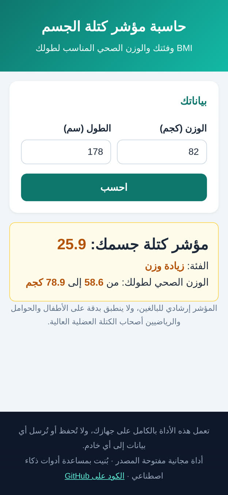

# BMI Calculator | حاسبة مؤشر كتلة الجسم

Calculate your body mass index, see your category and the healthy weight range for your height. Arabic interface.

**Live app:** https://abood-ayman.github.io/bmi-calculator-ar/

**LinkedIn:** [Project entry](https://www.linkedin.com/in/abdullah-ayman-1678b737b/details/projects/)

This is a personal project, built with AI tools.

## Features
- Instant BMI from weight and height
- Result classified by WHO categories
- Healthy weight range for your height in kilograms
- Clear notes about the index limits (athletes, children, pregnancy)

## Note
BMI is a general indicator, not a medical diagnosis.

## Privacy
Everything runs in your browser. No data is stored or sent anywhere.

## Run locally
Open `index.html` in any browser. It is a single static page with no dependencies.

## Status
Stable.

## Copyright
MIT License - Copyright (c) 2026 Abdullah Ayman.
